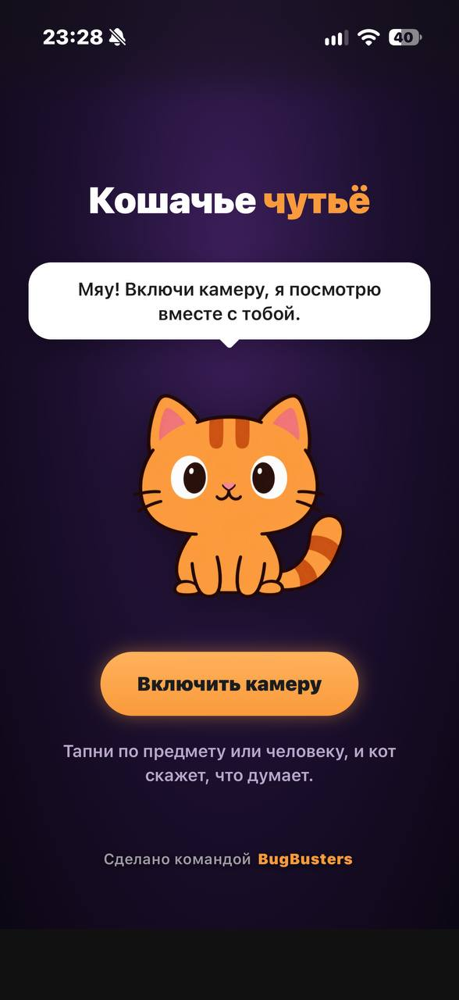
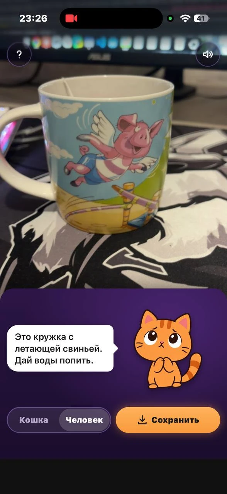
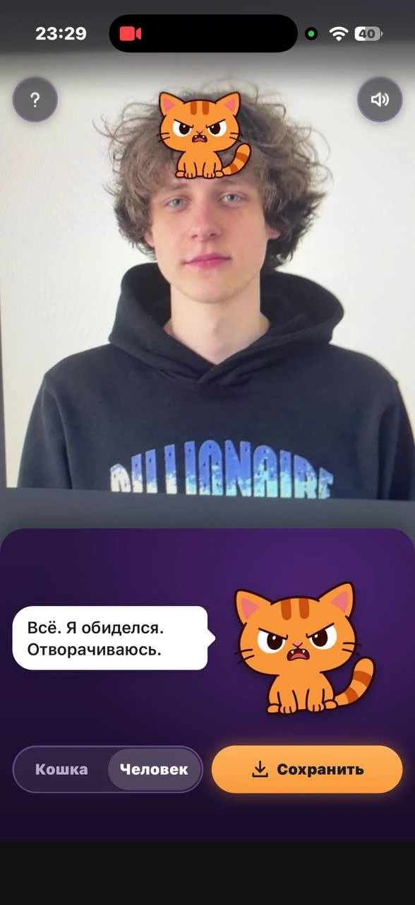
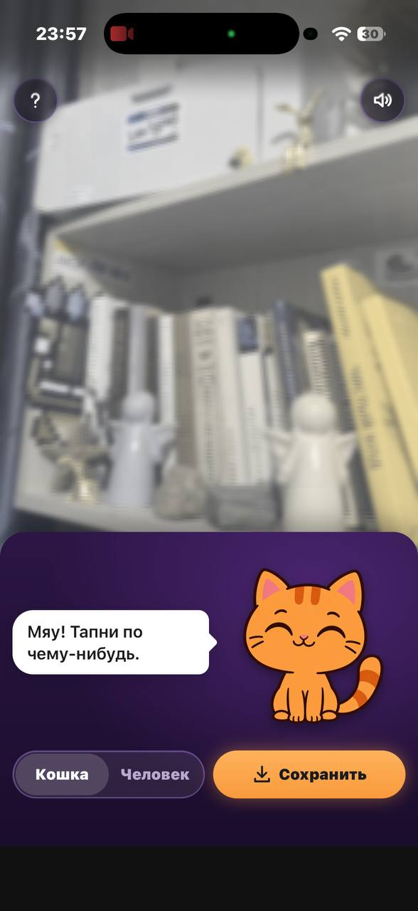
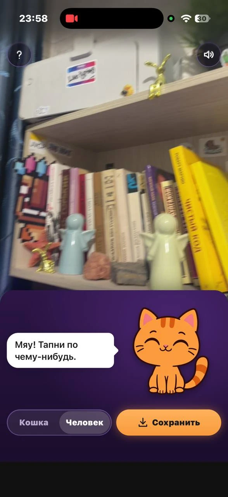

# Кошачье чутьё

Веб-приложение для телефона. Наводишь камеру и видишь мир глазами кошки. Тапаешь по предмету или человеку, и рыжий кот рассказывает, что видит и чего хочет.

**[cat-sense.vercel.app](https://cat-sense.vercel.app/)**: открыть с телефона, ставить ничего не надо.

<p align="center">
  
  
  
</p>

Сделано за 3 дня на хакатоне «Арена героев» командой **BugBusters** (2 человека). Тема хакатона «Чувствуй». Из трёх предложенных идей мы взяли две: «мир глазами котика» и «шумодав для конкретного человека».

## Что умеет

### Кошачье зрение

Кошки различают меньше цветов: красный и зелёный у них сливаются, картинка мягче. Фильтр работает на живом видео, переключатель «Кошка/Человек» показывает разницу.

<p align="center">
  
  
</p>

В основе матрица дейтеранопии (Machado, 2009), плюс насыщенность, размытие и виньетка. Рисуется WebGL-шейдером: Safari на iPhone игнорирует SVG-фильтры на `<video>`. Без WebGL включается запасной CSS-фильтр. Это приближение: точной научной модели кошачьего зрения нет.

### Кот комментирует предметы

Тап по любому предмету: вырезка кадра вокруг пальца уходит в Gemini, и кот отвечает своими словами. Каждую реплику пишет модель. Не уверена, что видит: кот спрашивает или догадывается. Пока модель думает, кот показывает, что размышляет. Если ответ не пришёл за 9,5 секунды, кот говорит запасную фразу из `phrases.json`, и приложение работает дальше.

### Кот реагирует на эмоции

Тап по лицу: эмоцию (радость, удивление, злость, нейтральное лицо) определяет MediaPipe Face Landmarker прямо на телефоне. На сервер уходит только название эмоции, само лицо не уходит.

### Обида

Это наш вариант «шумодава». Задержи палец на человеке, и кот обидится: сядет ему на голову злым котом и перестанет дружить. Кот помнит обидчика 2 минуты, даже если тот ушёл из кадра, и узнаёт его по цветам волос и одежды и пропорциям лица. Всё считается на телефоне, ничего не хранится и не отправляется. Повторное удержание: мир.

### Маска героя

Пасхалка для стенда. Кот замечает на футболке лого организатора хакатона, надевает маску и несколько реплик отвечает как супергерой.

### Сохранить кадр

Кадр с котом и его репликой собирается на canvas и открывается в системном меню «Поделиться». В сеть фото не уходит.

## Приватность

Камера смотрит на людей на стенде, поэтому это продумали с самого начала:

- Лица, люди и эмоции распознаются на телефоне (TensorFlow.js + COCO-SSD, MediaPipe). Видеопоток на сервер не уходит.
- Сервер получает только вырезку кадра при тапе по предмету. Все лица на ней закрашиваются до отправки. Для лого на футболке отправляется вырезка одежды, и то только если её пропустил локальный фильтр, лица на ней тоже закрашены.
- Тело без лица программа считает человеком, и тогда картинка не отправляется вовсе. Статуэтки отличаются по уверенности детектора.
- Цепочка в проде: телефон → функция на Vercel → ProxyAPI (сторонний прокси) → Gemini.
- Ключ API лежит только в переменных окружения Vercel. Функция ограничивает размер и частоту запросов.

## Как устроено

```
Телефон (браузер)                              Vercel (serverless)
  камера + WebGL-фильтр
  COCO-SSD: люди
  Face Landmarker: лица и эмоции
  тап
    |-- кот "думает"
    `-- POST /api/ask  ------------------------>  проверка входа, лимиты
                                                    |
                                                  Gemini (картинка + промпт кота)
                                                    |
        реплика и настроение кота  <-------------- { text, mood, sure }
        (ошибка или таймаут: фраза из phrases.json)
```

| Часть | Технология |
|---|---|
| Фронтенд | чистый JavaScript (ES-модули), без фреймворка и сборки |
| Кошачье зрение | WebGL-шейдер поверх `<video>` |
| Люди | TensorFlow.js + COCO-SSD |
| Лица и эмоции | MediaPipe Face Landmarker, blendshapes и правила |
| Предметы и реплики | Gemini через `/api/ask` |
| Бэкенд | serverless-функции на Node.js |
| Хостинг | Vercel: статика из `public/`, функции из `api/` |
| Тесты | `node --test`, 310 тестов на логику и API |

Логика без DOM и камеры вынесена в [`public/js/logic/`](public/js/logic/) и покрыта тестами: выбор цели тапа, эмоции по blendshapes, трекинг и узнавание обидчика, фильтр лого, таймауты и запасные фразы. Камеру, анимацию и звук проверяли руками на iPhone.

Подробнее: [архитектура и контракт API](.memory-bank/architecture.md), [принятые решения](.memory-bank/decisions.md).

## Как мы работали

Код писали вдвоём с [Claude Code](https://claude.com/claude-code), один на Windows, второй на Linux. Процесс взяли из облегчённого [labs-harness](https://github.com/ayusavin/labs-harness):

- **Memory Bank** ([`.memory-bank/`](.memory-bank/)): факты о проекте и решения. Агенты читают его перед любой задачей.
- **Цикл** `/plan` → `/build` → `/debug` → `/review`: план с критериями приёмки, реализация агентом, которому принадлежат файлы, отладка с воспроизведения, ревью перед деплоем. Планы и отчёты лежат в [`swarm-report/`](swarm-report/).
- **Тест-гейт**: Stop-хук не даёт агенту сказать «готово», если менялась логика, а тесты не запускались.

Правила для агентов: [AGENTS.md](AGENTS.md).

## Запуск локально

Нужен Node.js 22 или новее. Зависимостей нет.

```bash
npm run dev
```

Сайт откроется на `http://localhost:5173/` вместе с `/api/ask` и `/api/ping`. Ключ Gemini кладётся в `.env` как `GEMINI_API_KEY` (образец в `.env.example`). Без ключа кот говорит запасные фразы. Камера работает на `localhost`, а с другого устройства по Wi-Fi нужен HTTPS.

```bash
npm test
```

Деплой: `npx vercel deploy`. На iPhone удобнее открывать с экрана «Домой» (Safari → Поделиться → На экран «Домой»): так нет интерфейса браузера. Проверка деплоя: `/check.html`.

## Лицензии

Код, кот, звуки и название проекта: © BugBusters, все права защищены. Смотреть и изучать можно, использовать и распространять нельзя без разрешения авторов.

Файлы в `.claude/` основаны на [labs-harness](https://github.com/ayusavin/labs-harness), MIT, текст лицензии в [.claude/HARNESS-LICENSE](.claude/HARNESS-LICENSE).
